  <picture>
    <source media="(prefers-color-scheme: dark)" srcset="./github-banner-dark.svg" />
    <source media="(prefers-color-scheme: light)" srcset="./github-banner-light.svg" />
    
  </picture>

  <a href="https://github.com/xDiego1st">
    <picture>
      <source media="(prefers-color-scheme: dark)" srcset="https://readme-typing-svg.demolab.com?font=Fira+Code&weight=600&size=20&duration=3000&pause=1000&color=70A5FD&center=true&vCenter=true&width=640&lines=Full-Stack+Web+Developer+%28Laravel+%26+Livewire%29;Enterprise+GIS+%26+Real-Time+Tracking+Systems;Cross-Platform+CLI+%26+Automation+Builder;Mobile+Development+Explorer+%28Kotlin+%26+Flutter%29" />
      <source media="(prefers-color-scheme: light)" srcset="https://readme-typing-svg.demolab.com?font=Fira+Code&weight=600&size=20&duration=3000&pause=1000&color=2563EB&center=true&vCenter=true&width=640&lines=Full-Stack+Web+Developer+%28Laravel+%26+Livewire%29;Enterprise+GIS+%26+Real-Time+Tracking+Systems;Cross-Platform+CLI+%26+Automation+Builder;Mobile+Development+Explorer+%28Kotlin+%26+Flutter%29" />
      
    </picture>
  </a>

  <a href="mailto:rasyidabdullhalim@gmail.com">
    <picture>
      <source media="(prefers-color-scheme: dark)" srcset="https://img.shields.io/badge/Email-1a1b27?style=for-the-badge&logo=gmail&logoColor=EA4335" />
      <source media="(prefers-color-scheme: light)" srcset="https://img.shields.io/badge/Email-f1f5f9?style=for-the-badge&logo=gmail&logoColor=DC2626" />
      
    </picture>
  </a>
  <a href="https://youtube.com/@guidedcoding" target="_blank">
    <picture>
      <source media="(prefers-color-scheme: dark)" srcset="https://img.shields.io/badge/YouTube-1a1b27?style=for-the-badge&logo=youtube&logoColor=FF0000" />
      <source media="(prefers-color-scheme: light)" srcset="https://img.shields.io/badge/YouTube-f1f5f9?style=for-the-badge&logo=youtube&logoColor=DC2626" />
      
    </picture>
  </a>
  <a href="https://instagram.com/rasyidabdullhalim" target="_blank">
    <picture>
      <source media="(prefers-color-scheme: dark)" srcset="https://img.shields.io/badge/Instagram-1a1b27?style=for-the-badge&logo=instagram&logoColor=E4405F" />
      <source media="(prefers-color-scheme: light)" srcset="https://img.shields.io/badge/Instagram-f1f5f9?style=for-the-badge&logo=instagram&logoColor=DB2777" />
      
    </picture>
  </a>
  <a href="https://facebook.com/rasyidabdulhalim" target="_blank">
    <picture>
      <source media="(prefers-color-scheme: dark)" srcset="https://img.shields.io/badge/Facebook-1a1b27?style=for-the-badge&logo=facebook&logoColor=1877F2" />
      <source media="(prefers-color-scheme: light)" srcset="https://img.shields.io/badge/Facebook-f1f5f9?style=for-the-badge&logo=facebook&logoColor=1D4ED8" />
      
    </picture>
  </a>
  <!-- Optional: uncomment and add your URLs when ready
  <a href="https://linkedin.com/in/YOUR_USERNAME" target="_blank">
    <picture>
      <source media="(prefers-color-scheme: dark)" srcset="https://img.shields.io/badge/LinkedIn-1a1b27?style=for-the-badge&logo=linkedin&logoColor=0A66C2" />
      <source media="(prefers-color-scheme: light)" srcset="https://img.shields.io/badge/LinkedIn-f1f5f9?style=for-the-badge&logo=linkedin&logoColor=0A66C2" />
      
    </picture>
  </a>
  <a href="https://your-portfolio-url.com" target="_blank">
    <picture>
      <source media="(prefers-color-scheme: dark)" srcset="https://img.shields.io/badge/Portfolio-1a1b27?style=for-the-badge&logo=googlechrome&logoColor=70A5FD" />
      <source media="(prefers-color-scheme: light)" srcset="https://img.shields.io/badge/Portfolio-f1f5f9?style=for-the-badge&logo=googlechrome&logoColor=2563EB" />
      
    </picture>
  </a>
  -->
  <picture>
    <source media="(prefers-color-scheme: dark)" srcset="https://komarev.com/ghpvc/?username=xDiego1st&label=Profile+Views&color=1a1b27&style=for-the-badge" />
    <source media="(prefers-color-scheme: light)" srcset="https://komarev.com/ghpvc/?username=xDiego1st&label=Profile+Views&color=2563eb&style=for-the-badge" />
    
  </picture>

---

## 👨‍💻 About Me

Hi, I'm **Rasyid Abdul Halim** (`@xDiego1st`) — a **Full-Stack Web & Mobile Developer** based in **Indonesia**, building scalable web platforms and public-service digital infrastructure at **Diskominfo**. I focus on bridging reliable backend architecture with responsive UI, real-time geospatial mapping, and practical developer automation.

| Focus | Details |
| :--- | :--- |
| 🔭 **Currently Working On** | Production web platforms & geospatial tracking systems with **Laravel**, **Livewire**, and **MapLibre GL JS** |
| 🌱 **Currently Exploring** | Native Android engineering with **Kotlin**, mobile systems, and cross-platform CLI tooling |
| 👯 **Open to Collaborate** | Full-stack web applications, real-time GIS & fleet tracking, messaging gateways, and mobile projects |
| 🤝 **Looking to Connect** | Engineers & teams building with **Laravel / Livewire**, clean APIs, and applied automation |
| 💬 **Ask Me About** | **Laravel**, **Livewire**, interactive GIS maps, WhatsApp integration gateways, and Python terminal tools |
| ⚡ **Engineering Mindset** | Curious system tinkerer — I enjoy dissecting how software works under the hood and automating repetitive workflows |
| ☕ **Daily Fuel** | *Coffee & Code* |

---

## 🚀 Featured Projects

  <a href="https://github.com/xDiego1st/laravel-mapku">
    <picture>
      <source media="(prefers-color-scheme: dark)" srcset="https://github-readme-stats.vercel.app/api/pin/?username=xDiego1st&repo=laravel-mapku&theme=tokyonight&border_color=292e42" />
      <source media="(prefers-color-scheme: light)" srcset="https://github-readme-stats.vercel.app/api/pin/?username=xDiego1st&repo=laravel-mapku&bg_color=ffffff&title_color=2563eb&icon_color=2563eb&text_color=334155&border_color=e2e8f0" />
      
    </picture>
  </a>
  <a href="https://github.com/xDiego1st/XToolKit">
    <picture>
      <source media="(prefers-color-scheme: dark)" srcset="https://github-readme-stats.vercel.app/api/pin/?username=xDiego1st&repo=XToolKit&theme=tokyonight&border_color=292e42" />
      <source media="(prefers-color-scheme: light)" srcset="https://github-readme-stats.vercel.app/api/pin/?username=xDiego1st&repo=XToolKit&bg_color=ffffff&title_color=2563eb&icon_color=2563eb&text_color=334155&border_color=e2e8f0" />
      
    </picture>
  </a>
   
  <a href="https://github.com/xDiego1st/wa-integration">
    <picture>
      <source media="(prefers-color-scheme: dark)" srcset="https://github-readme-stats.vercel.app/api/pin/?username=xDiego1st&repo=wa-integration&theme=tokyonight&border_color=292e42" />
      <source media="(prefers-color-scheme: light)" srcset="https://github-readme-stats.vercel.app/api/pin/?username=xDiego1st&repo=wa-integration&bg_color=ffffff&title_color=2563eb&icon_color=2563eb&text_color=334155&border_color=e2e8f0" />
      
    </picture>
  </a>

 

| Project | Stack | Highlights |
| :--- | :--- | :--- |
| [**laravel-mapku**](https://github.com/xDiego1st/laravel-mapku) | `Laravel 10–13` · `MapLibre GL JS` · `JS` | Enterprise-grade GIS & real-time fleet tracking package featuring built-in anti-CORS tile proxy caching, multi-instance isolation, dynamic GeoJSON boundaries, and glassmorphism UI. |
| [**XToolKit**](https://github.com/xDiego1st/XToolKit) | `Python` · `Textual` · `ADB` · `PowerShell` | Cross-platform Windows & macOS terminal dashboard and CLI toolkit for Android/ADB diagnostics, automatic connection recovery, and Frida instrumentation workflows. |
| [**wa-integration**](https://github.com/xDiego1st/wa-integration) | `Laravel` · `Blade` · `PHP` | Modular WhatsApp Integration Gateway designed for automated notifications and messaging workflows. |

---

## 🛠️ Tech Stack & Creative Toolkit

  
<strong>Languages, Frameworks &amp; Mobile</strong>

  <picture>
    <source media="(prefers-color-scheme: dark)" srcset="https://skillicons.dev/icons?i=php,laravel,python,js,kotlin,flutter,java,cs,powershell&theme=dark" />
    <source media="(prefers-color-scheme: light)" srcset="https://skillicons.dev/icons?i=php,laravel,python,js,kotlin,flutter,java,cs,powershell&theme=light" />
    
  </picture>
    
  
<strong>Databases, Cloud &amp; Creative Suite</strong>

  <picture>
    <source media="(prefers-color-scheme: dark)" srcset="https://skillicons.dev/icons?i=mysql,sqlite,firebase,gcp,heroku,figma,blender,ps,ae,pr&theme=dark" />
    <source media="(prefers-color-scheme: light)" srcset="https://skillicons.dev/icons?i=mysql,sqlite,firebase,gcp,heroku,figma,blender,ps,ae,pr&theme=light" />
    
  </picture>

 

  <picture>
    <source media="(prefers-color-scheme: dark)" srcset="https://img.shields.io/badge/Livewire-1a1b27?style=for-the-badge&logo=livewire&logoColor=FB70A9" />
    <source media="(prefers-color-scheme: light)" srcset="https://img.shields.io/badge/Livewire-f1f5f9?style=for-the-badge&logo=livewire&logoColor=E11D48" />
    
  </picture>
  <picture>
    <source media="(prefers-color-scheme: dark)" srcset="https://img.shields.io/badge/MariaDB-1a1b27?style=for-the-badge&logo=mariadb&logoColor=00758F" />
    <source media="(prefers-color-scheme: light)" srcset="https://img.shields.io/badge/MariaDB-f1f5f9?style=for-the-badge&logo=mariadb&logoColor=005F73" />
    
  </picture>
  <picture>
    <source media="(prefers-color-scheme: dark)" srcset="https://img.shields.io/badge/Apache-1a1b27?style=for-the-badge&logo=apache&logoColor=D22128" />
    <source media="(prefers-color-scheme: light)" srcset="https://img.shields.io/badge/Apache-f1f5f9?style=for-the-badge&logo=apache&logoColor=D22128" />
    
  </picture>
  <picture>
    <source media="(prefers-color-scheme: dark)" srcset="https://img.shields.io/badge/Swagger-1a1b27?style=for-the-badge&logo=swagger&logoColor=85EA2D" />
    <source media="(prefers-color-scheme: light)" srcset="https://img.shields.io/badge/Swagger-f1f5f9?style=for-the-badge&logo=swagger&logoColor=16A34A" />
    
  </picture>
  <picture>
    <source media="(prefers-color-scheme: dark)" srcset="https://img.shields.io/badge/Codecov-1a1b27?style=for-the-badge&logo=codecov&logoColor=F01F7A" />
    <source media="(prefers-color-scheme: light)" srcset="https://img.shields.io/badge/Codecov-f1f5f9?style=for-the-badge&logo=codecov&logoColor=E11D48" />
    
  </picture>
  <picture>
    <source media="(prefers-color-scheme: dark)" srcset="https://img.shields.io/badge/Homebridge-1a1b27?style=for-the-badge&logo=homebridge&logoColor=9C59D1" />
    <source media="(prefers-color-scheme: light)" srcset="https://img.shields.io/badge/Homebridge-f1f5f9?style=for-the-badge&logo=homebridge&logoColor=6D28D9" />
    
  </picture>

---

## 📊 GitHub Analytics

  <picture>
    <source media="(prefers-color-scheme: dark)" srcset="https://github-readme-stats.vercel.app/api?username=xDiego1st&show_icons=true&include_all_commits=true&theme=tokyonight&border_color=292e42" />
    <source media="(prefers-color-scheme: light)" srcset="https://github-readme-stats.vercel.app/api?username=xDiego1st&show_icons=true&include_all_commits=true&bg_color=ffffff&title_color=2563eb&icon_color=2563eb&text_color=334155&border_color=e2e8f0" />
    
  </picture>
  <picture>
    <source media="(prefers-color-scheme: dark)" srcset="https://github-readme-stats.vercel.app/api/top-langs/?username=xDiego1st&layout=compact&theme=tokyonight&border_color=292e42" />
    <source media="(prefers-color-scheme: light)" srcset="https://github-readme-stats.vercel.app/api/top-langs/?username=xDiego1st&layout=compact&bg_color=ffffff&title_color=2563eb&text_color=334155&border_color=e2e8f0" />
    
  </picture>
    
  <picture>
    <source media="(prefers-color-scheme: dark)" srcset="https://streak-stats.demolab.com/?user=xDiego1st&theme=tokyonight&border=292e42" />
    <source media="(prefers-color-scheme: light)" srcset="https://streak-stats.demolab.com/?user=xDiego1st&background=ffffff&border=e2e8f0&stroke=e2e8f0&ring=2563eb&fire=2563eb&currStreakNum=0f172a&sideNums=0f172a&currStreakLabel=2563eb&sideLabels=334155&dates=64748b" />
    
  </picture>
    
  <picture>
    <source media="(prefers-color-scheme: dark)" srcset="https://github-readme-activity-graph.vercel.app/graph?username=xDiego1st&theme=tokyo-night&bg_color=1a1b27&color=70a5fd&line=38bdae&point=bf91f3&area=true&hide_border=true&custom_title=Contribution%20Activity" />
    <source media="(prefers-color-scheme: light)" srcset="https://github-readme-activity-graph.vercel.app/graph?username=xDiego1st&bg_color=ffffff&color=1e293b&line=2563eb&point=0284c7&area=true&area_color=bfdbfe&hide_border=true&custom_title=Contribution%20Activity" />
    
  </picture>

  <picture>
    <source media="(prefers-color-scheme: dark)" srcset="./github-footer-dark.svg" />
    <source media="(prefers-color-scheme: light)" srcset="./github-footer-light.svg" />
    
  </picture>

